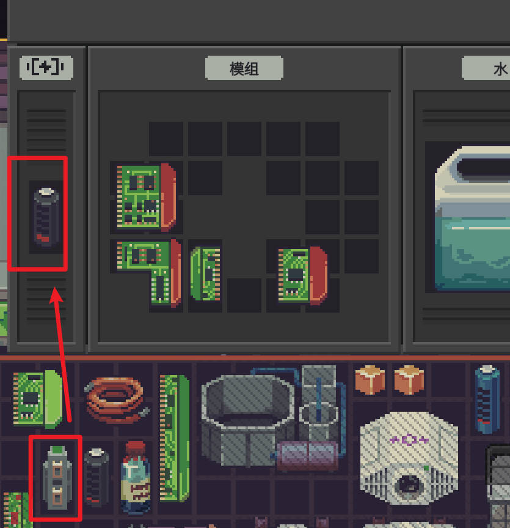
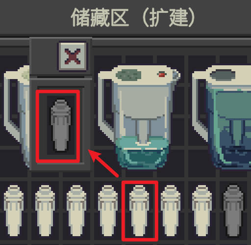

# [QoL] Shopkeeper's Kit: Quick Swap

**English** | [中文](README.zh-CN.md)

> Part of the **Shopkeeper's Kit** series · category **[QoL]**: no balance changes, it only saves clicks. See the [repository home](../../README.md) for the series and categories.
> By ChaosN · developed with assistance from [Claude Code](https://claude.com/claude-code) (Anthropic's AI coding assistant). Mod ID: `chaos5090.conveniences`.
>
> **Steam Workshop: [subscribe here](https://steamcommunity.com/sharedfiles/filedetails/?id=3837822167)**

UI in Chinese or English, following the game's language (Chinese shows Chinese, every other language shows English).

This mod is a **collection of small QoL features with no balance impact**: new features of this kind go here instead of into separate mods. It currently contains:

- Drop to swap: batteries and water filters (details below)
- One-key water filling: hold a bottle and press W to fill a tank with tap water (1.1.0)

## Screenshots

Left: drop a new battery to replace the one in the machine (current converters swap too). Right: drop a new water filter on a pitcher to replace the used one.

 

## Drop to swap: batteries and water filters

In the base game, swapping a machine's battery or a water pitcher's filter means opening its window, dragging the old one out and the new one in. Dropping the new one on the **closed** machine works only when the slot is empty; when the old one is still inside, the drop is shown in red and nothing happens.

This mod makes that drop work:

- **Batteries**: drop a new battery on a machine → it replaces the battery inside, and the old battery goes where the new one was (same cell, same orientation);
- **Filters**: drop a new filter on a water pitcher, same thing. Other items whose window has a filter slot at the top level work too;
- while you hover the machine with the new part, it is highlighted green with the base game's green "use on" tooltip; release to swap.

Unchanged:

- an empty slot, or any other free spot in the machine that accepts the item, is filled as in the base game;
- base-game drop effects (e.g. dropping a battery on another battery to swap them) are handled by the base game;
- slot rules still apply (e.g. a water pitcher refuses UV filters, so nothing is swapped);
- only your own items, one item at a time; nothing is swapped when you group-drag several items;
- with Filter Recharge installed, dropping a water filter on a pitcher that holds an Advanced Water Filter recharges it instead of swapping it out;
- if the old part has a different shape and doesn't fit the new part's old cell, it goes to any free spot in the storage/box the new part came from; if there's no room there either, nothing is swapped and you get a short message.

## One-key water filling (W)

While holding a bottle (any liquid container), press **W** (rebindable in the game's Options; R is taken by the game's "reset orientation of the held item", so it isn't used):

- **On the tap**: fill the bottle with tap water without letting go.
- **On a container, bottle has liquid**: pour it in, exactly like dropping it (same sounds and filter wear).
- **On a container, bottle is empty**: keep filling the bottle at the tap and pouring it in until the container is full, in one go. It's the same as running back and forth yourself: the water has today's rust water / gutterflow purity and filters wear the same way.
- A bottle that already holds liquid never gets tap water added, so your clean water isn't mixed with tap water.
- The tap needs the rust water or gutterflow pipe (game rule). One bottle at a time.
- After W the bottle goes back to its place (like cancelling the drag with ESC); drag it again to pour somewhere else. If nothing happens (target full, can't pour) you keep holding it.

## Install

1. After building (see "Build from source" on the [repository home](../../README.md)), copy the whole `dist/Conveniences/` folder into the game's `Mods` folder:
   ```
   <game folder>/Mods/Conveniences/manifest.xml
   <game folder>/Mods/Conveniences/Conveniences.dll
   ```
   The DLL is locked while the game runs, so quit the game first.
2. Start the game → main menu **Mods** → select **[QoL] Shopkeeper's Kit: Quick Swap** → **Review and enable** → restart when asked.
3. This mod requests **no special capabilities**; the game's own scanner ([`tools/ScanCheck`](../../tools/ScanCheck)) reports no capabilities, not refused, no findings.

## Settings

Mods screen → select this mod → **Settings**, or edit `%USERPROFILE%\AppData\LocalLow\Questing Goose Studio\Probably Stolen\ModConfigs\chaos5090.conveniences.json`.

| Key | Default | Meaning |
|---|---|---|
| `batteries` | `true` | Drop a battery on a machine to swap |
| `filters` | `true` | Drop a filter on a water pitcher to swap |
| `waterFill` | `true` | One-key water filling |
| `waterKey` | `W` | Water key (can also be bound in the game's Options) |

## How to test

1. Pick a machine that has a battery, with its window closed. Drag a battery from storage onto the machine: hovering highlights the machine in green with the green "use on" tooltip (not the red "can't insert"); after releasing, open the machine: the new battery is inside and the old one sits in the new one's old cell.
2. Same with a water pitcher that has a filter: drop a new filter on it.
3. Machine with an empty battery slot: the battery goes in as in the base game.
4. Battery dropped on another battery: swapped as in the base game.
5. Water: hold an empty bottle over a water tank and press W: the tank fills with tap water and you get "Filled … with N ml (M trips)"; with a filled bottle W pours just that bottle; over the tap W fills the bottle.
6. Search `Player.log` for `[Conveniences]`: every swap logs "换件：old → new (machine)", every fill logs "灌水…".

## Implementation

| File | Contents |
|---|---|
| `src/Swap.cs` | Rules and the swap. Patches: postfixes on `GameItem.MayTarget` / `CanTarget` (count the drop as "use on" when the swap rule holds), prefix on `GameItem.Target` (swap when the base game has no use effect for that pair), postfix on `GameSlotInventory.MayHaveValidInventorySlot` (only while the mouse is dragging that very item: report a slot holding the old part as not insertable, so hovering turns green) |
| `src/WaterFill.cs` | One-key water filling (a single pour uses the game's `GameItem.Target`; filling up with tap water uses the game's `WaterHelper.AddWater` / `TransferLiquid`, with the tap's own rules) |
| `src/ConveniencesBehaviour.cs` | The water key |
| `src/ConveniencesMod.cs` | Entry point, settings, key binding in the game's Options |

The swap uses the game's own `GraphUtils.SwapItemsInPlace` (the same function the base-game battery swap uses). A machine's battery slot comes from the game's `MachineHelper.GetBatterySlot`; other slots are taken from the top level of the item's window (single-slot windows or machine panels), never from items stored inside.

**Status**: builds and passes the game's mod scanner; **not yet tested in game**.

## Changelog

- **1.1.1**: Pressing W now ends the drag and puts the bottle back. Fixed: after filling, the bottle looked like it went back but was still being dragged, so releasing it over something else poured again.
- **1.1.0**: New one-key water filling (W): hold a bottle over the tap to fill it, over a container to pour, and an empty bottle over a container fills it up with tap water.
- **1.0.0**: First release: drop a battery on a machine or a filter on a water pitcher to swap. (Called "Drop Swap" / `chaos5090.drop-swap` during development; renamed to Quick Swap with the generic ID `chaos5090.conveniences` before release, as the home for QoL features.)
