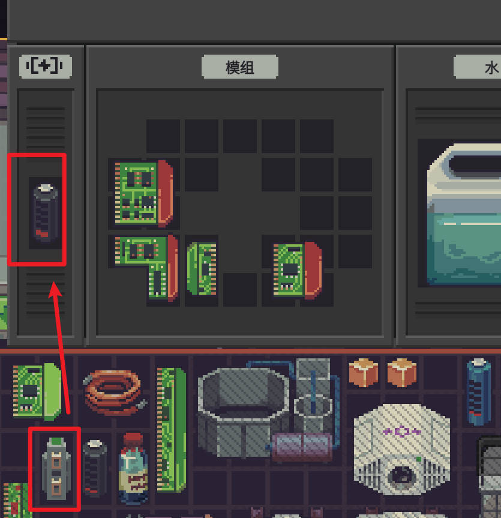
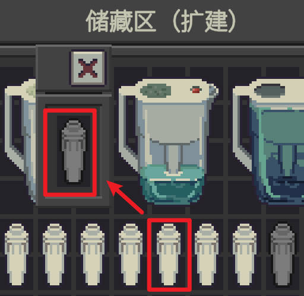

# 【便利】掌柜帮手·便利替换 Quick Swap

[English](README.md) | **中文**

> **掌柜帮手 / Shopkeeper's Kit** 系列 · 分类 **【便利】**：不改任何数值，只帮你省操作。系列与分类说明见 [仓库首页](../../README.zh-CN.md)。
> 作者 ChaosN · 由 [Claude Code](https://claude.com/claude-code)（Anthropic 的 AI 编程助手）协助开发。mod ID：`chaos5090.conveniences`。
>
> **Steam 创意工坊：[点这里订阅](https://steamcommunity.com/sharedfiles/filedetails/?id=3837822167)**

界面中英双语，跟随游戏的语言设置（中文显示中文，其他语言显示英文）。

本 mod 是**不影响平衡的小便利功能合集**：以后新增的这类功能都放在这里，不再单独开 mod。目前包含：

- 拖上去就换：电池、滤水器（下面详细说明）
- 一键灌水：拖着瓶子按 W，用自来水把桶灌满（1.1.0）

## 截图

左：新电池拖上去，换下机器里的旧电池（电流转换器也能互换）。右：新滤水器拖到水罐上，换下用旧的那个。

 

## 拖上去就换：电池、滤水器

原版里给机器换电池、给水罐换滤水器，要先打开它的窗口，把旧件拖出来，再把新件拖进去。把新件直接拖到**合着的**机器上时，槽空着能放进去；槽里已经有旧件就标红、什么都不做。

本 mod 让后一种情况也能用：

- **换电池**：把新电池拖到机器上 → 换下机器里的旧电池，旧电池放到新电池原来的位置（原来的格子、原来的朝向）；
- **换滤水器**：把新滤水器拖到水罐上，同理。窗口第一层有滤芯槽的其他设备（例如循环水养殖系统）也一样；
- 拖着新件指着机器时，机器显示绿色，提示框是原版“对物品使用”的那种绿色提示，松手就换。

不会改变的：

- 槽空着、或者机器里有别的空位能放时，照原版直接放进去；
- 原版本来就有的拖放效果（例如电池拖到另一块电池上互换）照原版处理；
- 槽自己的规则照旧（例如水罐不收紫外线灯，那就不换）；
- 只对你自己的东西生效，一次只换一件；多选一起拖时不换；
- 装了「滤水器充能」时，水罐里装着高级滤水器的话，拖滤水器上去是给它充能，不是换下来；
- 旧件的形状和新件不同、放不回原来的格子时，放进新件原来所在的仓库/箱子的任意空位；那里也放不下就不换，并提示一下。

## 一键灌水（W）

拖着瓶子（任何装液体的容器）时按 **W**（可在游戏“选项”里改；R 被游戏的“重置拿起的物品的朝向”占着，所以没用 R）：

- **指着水龙头**：把瓶子装满自来水，不用松手。
- **指着容器，瓶子里有水**：倒进去，和松手倒一样（声音、经过滤芯的耗损都照原版）。
- **指着容器，瓶子是空的**：用自来水来回“装满瓶子 → 倒进去”，直到容器满，一次做完。等于你自己在水龙头和容器之间跑很多趟：水质是今天的锈水 / 溢流水纯度，经过滤芯时一样消耗耐久。
- 瓶子里有水时不会接自来水，免得把你的净水和自来水混在一起。
- 水龙头要先解锁锈水或溢流水管道（游戏规则）。一次拿一个瓶子。
- 按完 W，瓶子放回原处（和按 ESC 取消拖动一样），要往别的容器倒就再拖一次。目标满了、不能倒时什么都不做，你可以继续拖着。

## 安装

1. 构建（见[仓库首页](../../README.zh-CN.md)“从源码构建”）后，把 `dist/Conveniences/` 整个文件夹复制到游戏目录的 `Mods` 文件夹里：
   ```
   <游戏目录>/Mods/Conveniences/manifest.xml
   <游戏目录>/Mods/Conveniences/Conveniences.dll
   ```
   游戏开着的时候 DLL 被锁住，替换前先退出游戏。
2. 启动游戏 → 主菜单 **改装件** → 选中 **【便利】掌柜帮手·便利替换** → **审阅并启用** → 按提示重启游戏。
3. 本 mod **不申请任何特殊权限**；用游戏自带的扫描器检查（[`tools/ScanCheck`](../../tools/ScanCheck)）结果是无权限、无拦截、无发现。

## 设置

改装件界面选中本 mod → **设置**；或编辑 `%USERPROFILE%\AppData\LocalLow\Questing Goose Studio\Probably Stolen\ModConfigs\chaos5090.conveniences.json`。

| 键 | 默认 | 说明 |
|---|---|---|
| `batteries` | `true` | 电池拖到机器上换电池 |
| `filters` | `true` | 滤水器拖到水罐上换滤水器 |
| `waterFill` | `true` | 一键灌水 |
| `waterKey` | `W` | 灌水键（也可以在游戏“选项”里按键绑定） |

## 怎么测试

1. 找一台装着电池的机器，窗口关着。从仓库拖一块电池到机器上：悬停时机器应显示绿色、提示框是绿色的使用提示（不是红色的“放不进”）；松手后打开机器，里面是新电池，旧电池在新电池原来的格子。
2. 水罐同理：装着滤水器的水罐，拖一个新滤水器上去。
3. 机器电池槽空着时拖电池上去：照原版直接放进去。
4. 电池拖到另一块电池上：照原版互换。
5. 灌水：拿一个空瓶指着储水罐按 W，罐子被自来水灌满，提示“灌了 N ml（来回 M 趟）”；拿着装水的瓶子指着罐子按 W，只倒这一瓶；指着水龙头按 W，瓶子装满。
6. 游戏日志 `Player.log` 里搜 `[Conveniences]`：每次换件有一行“换件：旧 → 新（机器）”，每次灌水有一行“灌水……”。

## 实现

| 文件 | 内容 |
|---|---|
| `src/Swap.cs` | 判断与换件。补丁：`GameItem.MayTarget` / `CanTarget` 后置（满足换件条件时算作“可以对它使用”），`GameItem.Target` 前置（原版对这一对没有使用效果时换件），`GameSlotInventory.MayHaveValidInventorySlot` 后置（只在鼠标正拖着这件物品时，把“装着旧件的槽”报告为放不进，让悬停显示绿色） |
| `src/WaterFill.cs` | 一键灌水（倒一瓶用游戏的 `GameItem.Target`；自来水灌满用游戏的 `WaterHelper.AddWater` / `TransferLiquid`，水龙头的规则照原版） |
| `src/ConveniencesBehaviour.cs` | 灌水键 |
| `src/ConveniencesMod.cs` | 入口、配置、游戏“选项”里的按键绑定 |

换件优先用游戏自己的 `GraphUtils.SwapItemsInPlace`（原版电池互换用的同一个函数）。机器的电池槽用游戏的 `MachineHelper.GetBatterySlot`；其他槽从窗口第一层（单槽窗口或机器面板）找，不进入里面装着的物品。

**状态**：已编译、已通过游戏扫描器检查；**尚未进游戏实测**。

## 更新记录

- **1.1.1**：按 W 灌水后结束这次拖动、瓶子放回原处。修复：原来灌完水瓶子看起来回到了原位，其实还在“拖着”，之后在别的东西上松手又会倒一次。
- **1.1.0**：新增一键灌水（W）：拖着瓶子指着水龙头装水、指着容器倒水，空瓶指着容器就用自来水灌满。
- **1.0.0**：首版：拖到机器上换电池、拖到水罐上换滤水器。（开发时叫“拖放换件”、ID `chaos5090.drop-swap`；上传前改名为“便利替换”，ID 改为通用的 `chaos5090.conveniences`，作为便利功能合集）
