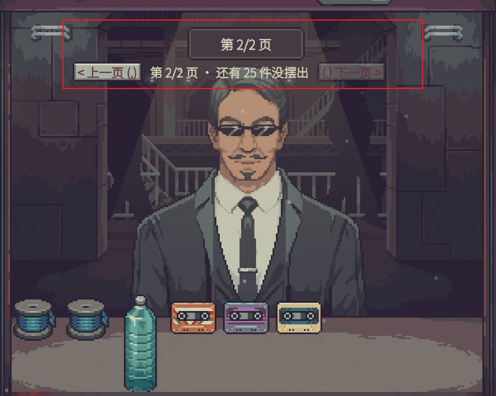

# [Fix] Shopkeeper's Kit: Counter Overflow

**English** | [中文](README.zh-CN.md)

> Part of the **Shopkeeper's Kit** (掌柜帮手) series · category **[Fix]** (【修复】): fixes a game bug, with a small effect on balance. See the [repository home](../../README.md) for the series and categories.
> By ChaosN · developed with assistance from [Claude Code](https://claude.com/claude-code) (Anthropic's AI coding assistant). Mod ID: `chaos5090.counter-overflow`.
>
> **Steam Workshop: [subscribe here](https://steamcommunity.com/sharedfiles/filedetails/?id=3835916532)**

The in-game UI is in Chinese and English and follows the game's language (Chinese when the game is in Chinese, English otherwise).

## Screenshots

Items that don't fit on the counter go onto the next page. The page bar above the customer's head shows the page number and how many items are on other pages; press `Z` `X` or click the buttons to turn pages (the screenshots are from an older version that used `,` `.`). (The game was in Chinese.)

 

## The bug

When a seller (thieves, water sellers, the retired chemist, Dr. Jackson offering equipment, ...) visits, they lay their goods on the counter one by one. In the base game:

- if an item **doesn't fit** the counter's free space, it is **destroyed**;
- if the counter has **no free cell at all**, the remaining items are **never created**.

There is no message and you never see those items. The game log records it (`Destroyed unplaced items ... (front counter full)`); a single equipment offer from Dr. Jackson can lose twenty or more items.

The Workshop mod "防止小偷箱子被挤掉" only moves the thief's loot crate to the front of the line; everything else can still be lost. This mod stops all of it.

## How it works: pages

Items that don't fit go onto extra **pages**; one page is exactly one counter's worth.

- When there is more than one page, a page bar appears **right below** the notification above the customer's head (where "第 1/3 页" is shown): `< 上一页 (Z)    第 2/4 页 · 还有 12 件没摆出    (X) 下一页 >` ("previous / page 2 of 4 · 12 more not shown / next"). Click its buttons to flip;
- or use the keys: **Z** for the previous page and **X** for the next. Rebind them by pressing a key in the game's **Options** (section "掌柜帮手·柜台不丢货"), or edit them in the mod settings;
- every page **remembers where each item sat**: flip away and back and the items return to the same cells;
- **no automatic refilling**: when you take an item off the counter (e.g. drag it onto the scale to negotiate), the gap it leaves is not filled by other goods. Flip to another page and back and the gap is still there, so you can always put the item back;
- pages whose items have all been bought are dropped when you flip, except while customer goods are still on the scale (that item may have come from the empty page, so the page stays for you to return it);
- **when the customer leaves**, pages not on display are handled like leftover counter items in the base game: the customer's items leave with them (destroyed), anything that belongs to you (e.g. story gifts) goes to your storage.

When nothing is paged, pressing Z and X does nothing, so the keys stay free for other uses.

### Dr. Jackson's shop at night

When you visit Dr. Jackson (the scientist) at night, his goods are laid on the counter one by one through the same code. His counter is bigger than the daytime one (14×21 cells), but his equipment is large and plentiful, so with many network upgrades or a "special stock" night it still overflows, and the base game destroys the rest. This mod pages his goods too: the page bar sits right above the counter (there is no customer or notification above their head in his shop), with the same keys. When you leave his shop, pages not on display are handled like the base game (his goods stay, anything that belongs to you goes to your storage).

Unchanged: prices, negotiation and appraisal all happen on the real items, exactly as in the base game.

### Balance

You will see goods the base game would have destroyed, such as thieves' loot crates at high Black Market reputation or Dr. Jackson's full equipment offer, so you get more buying opportunities than in the base game. That's why this mod is [Fix] rather than [QoL].

### Notes

- A **wholesale** offer (one price for all the seller's goods) now buys **every page**, and the wholesale price already includes them (since 1.4.1; before, it only covered the page shown and the seller left afterwards, so the other pages couldn't be bought). You get a one-time hint when goods are paged.
- If you buy everything on the current page one by one, the seller no longer thinks they're sold out and leaves; the other pages can still be flipped to and bought (since 1.4.1).
- Pages not on display are not saved if you save and reload while goods are paged (in the base game they would have been destroyed anyway).
- If an item's old cell is taken when you flip back (e.g. you put something of yours there), it finds another free spot; if nothing fits, you get a "N items on this page don't fit" message.

## Install

**Recommended:** subscribe on the [Steam Workshop](https://steamcommunity.com/sharedfiles/filedetails/?id=3835916532), then in game open **Mods**, select the mod, click **Review and enable** and restart when asked. Steam keeps it updated.

Manual install (building from source):

1. Copy the whole `dist/CounterOverflow/` folder into the game's `Mods` folder:
   ```
   <game folder>/Mods/CounterOverflow/manifest.xml
   <game folder>/Mods/CounterOverflow/CounterOverflow.dll
   ```
   To build from source, see the [repository home](../../README.md). The DLL is locked while the game runs, so quit the game before replacing it.
2. Start the game → main menu **改装件** (Mods) → select **【修复】掌柜帮手·柜台不丢货** → **审阅并启用** (Review and enable) → restart when asked (the mod only loads after a restart).
3. The mod requests **no special capabilities**. The game's own mod scanner ([`tools/ScanCheck`](../../tools/ScanCheck)) reports no capabilities, no blocks and no findings.

## Settings

In game: Mods screen → select this mod → **设置** (Settings). Or edit `%USERPROFILE%\AppData\LocalLow\Questing Goose Studio\Probably Stolen\ModConfigs\chaos5090.counter-overflow.json`. The page keys can also be bound in the game's **Options**.

| Key | Default | Meaning |
|---|---|---|
| `enabled` | `true` | Page items that don't fit; off = base game behavior |
| `prevKey` | `Z` | Previous page (Unity KeyCode name) |
| `nextKey` | `X` | Next page |
| `pageBar` | `true` | Show the page bar (below the notification above the customer in your shop, above the counter at Dr. Jackson's) |
| `testMode` | `false` | Test mode, see below |

## Testing

The overflow only happens naturally with certain sellers, so the mod has a **test mode** that triggers it on demand.

> Back up your saves first: the `save_*.es3` files in `%USERPROFILE%\AppData\LocalLow\Questing Goose Studio\Probably Stolen\`. Ideally test on a new or unimportant save.

1. After enabling the mod, **restart the game once** (enabling without a restart doesn't load the mod, and the test mode setting won't show up).
2. Mods → this mod → Settings → turn on **测试模式** (test mode).
3. Load a save, open the shop and wait for any customer to reach the counter (a seller is best, so the items can be bought).
4. Press **Ctrl+X**: the customer lays out an extra batch of large equipment (fridge, water tank, moisture farm, water purifier, ...) through the normal game code. The counter will overflow.
5. Check:
   - a notification above the customer says the goods were split into N pages, and the page bar appears below it;
   - click "next" or press **X**: the counter shows the next page; press **Z** to go back and the items are in their old cells;
   - drag an item onto the scale, flip to the next page and back: its old cell is still empty and you can put it back;
   - after closing, open the game log `Player.log` (same folder) and search for `[CounterOverflow]`: you should see "moved to page N", "flipped to page N" and "customer left" entries, and **no new** `(front counter full)` destroy entries.
6. Dr. Jackson's shop: visit him at night and press **Ctrl+X** after arriving to make him lay out an extra batch. Check that the page bar appears right above the counter and flips pages; back in your shop, the log shows "离开dr_jackson，收起没摆出来的页" (left the location, pages cleaned up).
7. Turn test mode off afterwards. The test items are real and can be bought, which amounts to cheating.

Without test mode: Dr. Jackson's equipment offers and thieves at Black Market reputation 100+ overflow the counter easily.

## Implementation

| File | Contents |
|---|---|
| `src/Overflow.cs` | Patches (`GraphUtils.DestroyIfUnplaced` sends "front counter full" items to a later page instead of destroying them; `PlayerStore.TryAddDirectSellingItemToTable(string, …)` still creates the item when the counter is full), pages, stashing/restoring at exact coordinates (`GameInventory.TryInventorySlot` + `SlotMarker.TryAcceptOnce`), cleanup when the customer leaves, test mode |
| `src/PageBar.cs` | The page bar (the game's CustomUI framework), placed right below the game's notification box `ReputationUIManager.reputationNotifier` |
| `src/OverflowBehaviour.cs` | Keys, customer-left check every 0.2 s, notifications |
| `src/OverflowMod.cs` | Entry point, settings, key bindings in the game's Options |

Each page is an invisible grid with the counter's shape at the time, so an item's coordinates in it are its coordinates on the counter. Both patches run last: if another mod (e.g. Visitor Forecast simulating in its sandbox) asks to skip the original logic, this mod does nothing.

**Status**: builds and passes the game's mod scanner. 1.0.0 was tested in game (overflowing items are kept), and paging with the page bar has since been used in the shop; paging at Dr. Jackson's (1.4.0) is **not yet tested in game**.

## Changelog

- **1.4.1**: Fixed wholesale covering only one page: the wholesale price and purchase now include all pages, and the other pages' goods get the same price adjustments as goods placed on the scale, matching the base game. The seller no longer leaves early after you buy the current page one by one. The page bar disappears once the other pages are empty. When a customer leaves, your own goods that don't fit in storage go elsewhere in the shop instead of being destroyed.
- **1.4.0**: The page bar now also shows at Dr. Jackson's shop at night (above the counter); pages there are cleaned up when you leave the location rather than by watching who the customer is (his goods are laid out before he appears). Page keys in this README corrected to Z / X.
- **1.3.0**: Default page keys moved under the left hand: **Z / X** (previously `,` `.`); keys you already saved are kept. Rebinding a key in the game's Options no longer turns pages.
- **1.2.2**: Author name changed to ChaosN; screenshots and a Workshop preview added (no functional changes).
- **1.2.1**: No longer makes the game try to create a new save object in the main menu (it used `PlayerStore.Instance` to check whether a run is loaded; that getter creates one when none exists, which crashed in the constructor with a null reference).
- **1.2.0**: UI in Chinese and English, following the game language (notifications, page bar, settings).
- **1.1.3**: key settings accept a plain symbol or letter (e.g. / or K).
- **1.1.2**: fixed ESC not opening the menu while goods were paged (the page bar sat in the game's paper UI layer, where ESC treats it as a panel to close first; it reappeared every frame and swallowed ESC).
- **1.1.1**: the page bar moved below the notification above the customer's head, so it no longer overlaps the goods and the customer.
- **1.1.0**: fixed pages: page bar above the counter (previous/next, current page); page keys are now , and . and can be bound in the game's Options; each page remembers item positions and nothing refills automatically, so an item you took off can always go back.
- **1.0.0**: first version: overflowing items queued, refilled automatically when space freed up, F3 to flip.
