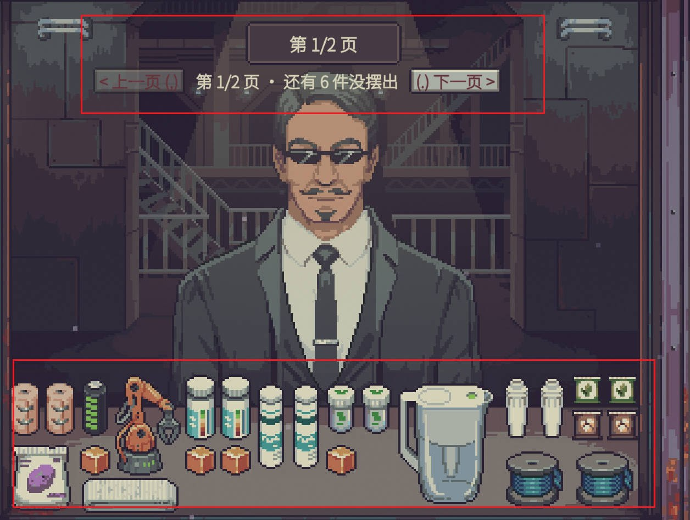
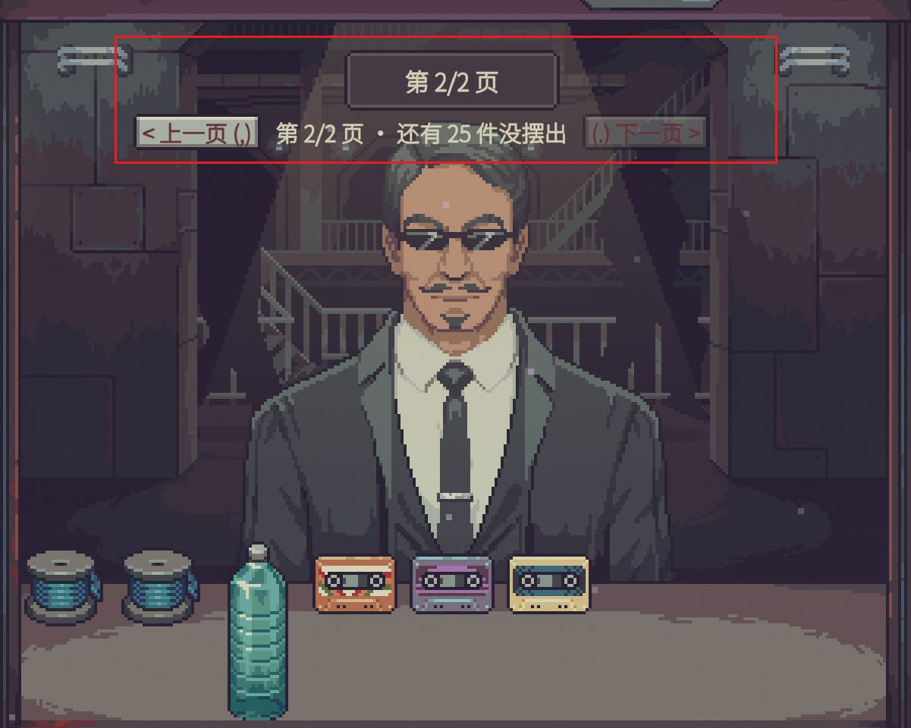

# 【修复】掌柜帮手·柜台不丢货 Counter Overflow

[English](README.md) | **中文**

> **掌柜帮手 / Shopkeeper's Kit** 系列 · 分类 **【修复】**：修游戏 bug，会稍微影响平衡。系列与分类说明见 [仓库首页](../../README.zh-CN.md)。
> 作者 ChaosN · 由 [Claude Code](https://claude.com/claude-code)（Anthropic 的 AI 编程助手）协助开发。mod ID：`chaos5090.counter-overflow`。
>
> **Steam 创意工坊：[点这里订阅](https://steamcommunity.com/sharedfiles/filedetails/?id=3835916532)**

界面中英双语，跟随游戏的语言设置（中文显示中文，其他语言显示英文）。

## 截图

柜台放不下的货自动分到下一页。顾客头顶上方是翻页条：第几页、别的页上还有几件；按 `Z` `X` 或点按钮翻页（截图是旧版，当时默认键还是 `,` `.`）。

 

## 修的是什么 bug

卖家（小偷、卖水的、退休化学家、杰克逊博士推销设备……）来店里时，会把货一件件摆到柜台上。原版里：

- 柜台**形状放不下**某件货 → 这件货被**直接销毁**；
- 柜台**一格都不剩** → 后面的货**根本不生成**。

没有任何提示，你也看不到这些货。游戏日志里能看到记录（`Destroyed unplaced items ... (front counter full)`），杰克逊博士来推销设备时，一次就可能丢掉二十多件。

创意工坊的“防止小偷箱子被挤掉”只是把小偷的战利品箱挪到最先摆出，其他货还是会丢。本 mod 让所有放不下的货都不再丢。

## 怎么用：分页

放不下的货会分到后面的**页**里，一页正好摆满一个柜台。

- 货分成多页时，顾客头上那条提示（显示“第 1/3 页”的地方）的**正下方**会出现翻页条：`< 上一页 (Z)    第 2/4 页 · 还有 12 件没摆出    (X) 下一页 >`，直接点按钮就能翻；
- 也可以按键：**Z** 上一页、**X** 下一页。按键可以在游戏的 **选项** 里按一下重新绑定（“掌柜帮手·柜台不丢货”一栏），也可以在改装件设置里改；
- 每一页**记住每件货的位置**：翻走再翻回来，货原样摆回原来的格子；
- **不会自动补货**：你把一件货拿下来（比如拖到秤上议价），它留下的空位不会被别的货占掉。翻到别的页、再翻回来，那个空位还在，想退回去随时能放回去；
- 货都买完的空页会在翻页时自动去掉。秤上还放着顾客的货时不去掉，留着让你放回去；
- **顾客离开**时，没摆出来的页按原版处理柜台剩货的方式处理：顾客的货随顾客离开（销毁），属于你的（例如剧情赠品）放进仓库。

平时（货没有分页时）按 Z 和 X 什么都不做，不影响别的用途。

### 晚上去杰克逊博士的店

晚上去杰克逊博士（科学家）的店里买东西时，他的货也是一件件摆到柜台上的，走的是同一段代码。他店里的柜台比白天大（14×21 格），但设备多、个头大，网络升级解锁得多或者赶上“特别存货”时一样会摆不下，原版同样直接销毁。本 mod 在他店里也分页：翻页条显示在柜台正上方（店里看不到顾客，没有头顶提示框），按键相同。离开他的店时，没摆出来的页按原版处理（他的货留在店里，属于你的放进仓库）。

不会改变的：货的价格、议价、鉴定，全都发生在真货上，和原版一样。

### 对平衡的影响

修好后你能看到原本会被销毁的货，比如黑市声望高时小偷的战利品箱、杰克逊博士一次带来的全部设备，进货机会比原版多。所以归在【修复】而不是【便利】。

### 注意

- 顾客提出“批发”（一口价买下柜台上所有货）时，只算当前这一页摆出来的货。
- 如果在货分页时存档、读档，没摆出来的页不会保存（原版里它们本来就被销毁了）。
- 翻回某一页时，如果原来的格子被别的东西占了（比如你把自己的东西放在了那里），这件货会自动找别的空位；实在放不下会提示“本页有 N 件放不下”。

## 安装

**推荐：**在 [Steam 创意工坊](https://steamcommunity.com/sharedfiles/filedetails/?id=3835916532)点订阅，进游戏打开 **改装件**，选中它点 **审阅并启用**，按提示重启。以后有新版本 Steam 会自动更新。

下面是手动安装（从源码构建）的步骤：

1. 把 `dist/CounterOverflow/` 整个文件夹复制到游戏目录的 `Mods` 文件夹里：
   ```
   <游戏目录>/Mods/CounterOverflow/manifest.xml
   <游戏目录>/Mods/CounterOverflow/CounterOverflow.dll
   ```
   从源码构建见[仓库首页](../../README.zh-CN.md)。游戏开着的时候 DLL 被锁住，替换前先退出游戏。
2. 启动游戏 → 主菜单 **改装件** → 选中 **【修复】掌柜帮手·柜台不丢货** → **审阅并启用** → 按提示重启游戏（启用后要重启一次才会生效）。
3. 本 mod **不申请任何特殊权限**；用游戏自带的扫描器检查（[`tools/ScanCheck`](../../tools/ScanCheck)）结果是无权限、无拦截、无发现。

## 设置

游戏内：改装件界面选中本 mod → **设置**；或编辑 `%USERPROFILE%\AppData\LocalLow\Questing Goose Studio\Probably Stolen\ModConfigs\chaos5090.counter-overflow.json`。翻页键也可以在游戏 **选项** 里按键绑定。

| 键 | 默认 | 说明 |
|---|---|---|
| `enabled` | `true` | 放不下的货分页显示；关掉 = 原版行为 |
| `prevKey` | `Z` | 上一页（Unity KeyCode 名称） |
| `nextKey` | `X` | 下一页 |
| `pageBar` | `true` | 显示翻页条（店里在顾客头上提示框下方，杰克逊博士店里在柜台上方） |
| `testMode` | `false` | 测试模式，见下 |

## 怎么测试

溢出要等特定的卖家才会自然发生，所以 mod 带了一个**测试模式**，可以随时人为制造溢出。

> 测试前先备份存档：`%USERPROFILE%\AppData\LocalLow\Questing Goose Studio\Probably Stolen\` 下的 `save_*.es3`。最好开个新档或用不重要的存档测。

1. 启用本 mod 后**重启一次游戏**（只在改装件里点“启用”而不重启，mod 不会加载，设置里也看不到测试模式）。
2. 改装件 → 本 mod → 设置 → 打开 **测试模式**。
3. 进存档、开门营业，等任意一位顾客走到柜台前（卖货的顾客最好，摆出来的货可以买）。
4. 按 **Ctrl+X**：顾客会按原版流程再往柜台摆一批大件设备（冰箱、水箱、集湿器、净水器……），柜台肯定放不下。
5. 检查：
   - 顾客头上提示“柜台放不下，货分成了 N 页”，提示下方出现翻页条；
   - 点“下一页”或按 **X**，柜台换成下一页的货；再按 **Z** 回到第一页，货在原来的位置；
   - 把一件货拖到秤上，翻到下一页再翻回来：那件货原来的格子还空着，可以放回去；
   - 打烊后打开游戏日志 `Player.log`（同一个文件夹），搜 `[CounterOverflow]`：能看到“放到第 N 页”“翻到第 N 页”“顾客离开，收起没摆出来的页”这些记录；**不应该再出现** `(front counter full)` 的销毁记录。
6. 杰克逊博士的店：晚上去他店里，到店后按 **Ctrl+X** 同样会多摆一批货。检查翻页条出现在柜台正上方、能翻页；回到店里后日志里有“离开dr_jackson，收起没摆出来的页”。
7. 测完把测试模式关掉。测试摆出的货是真的、可以买，等于作弊。

不用测试模式也行：杰克逊博士推销设备、黑市声望 100 以上时的小偷，都很容易让柜台溢出。

## 实现

| 文件 | 内容 |
|---|---|
| `src/Overflow.cs` | 补丁（`GraphUtils.DestroyIfUnplaced` 遇到 “front counter full” 时改为放进后面的页；`PlayerStore.TryAddDirectSellingItemToTable(string, …)` 在柜台全满时照常生成），分页、按原坐标收起/摆回（`GameInventory.TryInventorySlot` + `SlotMarker.TryAcceptOnce`）、顾客离开时清理，测试模式 |
| `src/PageBar.cs` | 翻页条（游戏的 CustomUI 框架），放在游戏提示框 `ReputationUIManager.reputationNotifier` 的正下方 |
| `src/OverflowBehaviour.cs` | 按键、每 0.2 秒检查顾客是否离开、提示 |
| `src/OverflowMod.cs` | 入口、配置、游戏“选项”里的按键绑定 |

每一页是一个看不见的格子，形状和柜台当时一样，货在里面的坐标就是它在柜台上的坐标。两个补丁都设为最后执行：其他 mod（例如访客预测在沙盒里模拟时）要求跳过原逻辑，这里就什么都不做。

**状态**：已编译、已通过游戏扫描器检查。1.0.0 已进游戏实测（溢出的货确实保住了），之后的分页与翻页条在店里实测可用；1.4.0 杰克逊博士店里的分页**尚未实测**。

## 更新记录

- **1.4.0**：晚上在杰克逊博士的店里也显示翻页条（放在柜台正上方）；他店里的分页改为离开这个地点时才收尾，不再看顾客是谁（到店时先摆货、后出现店主）。说明里的翻页键更正为 Z / X。
- **1.3.0**：默认翻页键改为左手区的 **Z / X**（原来是 `,` `.`）；已经保存过的键位不变。在游戏“选项”里改键时不再顺带翻页。
- **1.2.2**：作者名改为 ChaosN，加上截图和创意工坊预览图（功能没有变化）。
- **1.2.1**：主菜单里不再反复触发游戏新建存档对象（原来用 `PlayerStore.Instance` 判断是否在店里，而它在没有存档时会新建一个，于是在构造函数里报空引用）。
- **1.2.0**：界面中英双语，跟随游戏语言（提示、翻页条、设置项）。
- **1.1.3**：按键设置里可以直接填符号或字母（例如 / 或 K）。
- **1.1.2**：修复货分页时按 ESC 呼不出菜单（翻页条原来放在游戏的 paper 界面层，会被 ESC 当成面板先关掉、又被重新显示，把 ESC 吃掉了）。
- **1.1.1**：翻页条挪到顾客头上提示框的正下方，不再压在货物上、跟人物重影。
- **1.1.0**：改成固定分页：柜台上方的翻页条（上一页/下一页、第几页）；翻页键改为 , 和 .，可在游戏选项里绑定；每页记住每件货的位置，不再自动补位，拿下来的货随时能放回原处。
- **1.0.0**：首版：放不下的货排队，腾出位置自动补上，F3 翻页。
