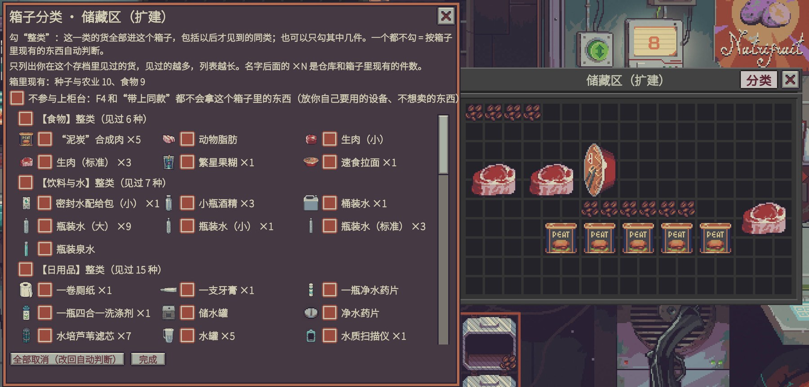
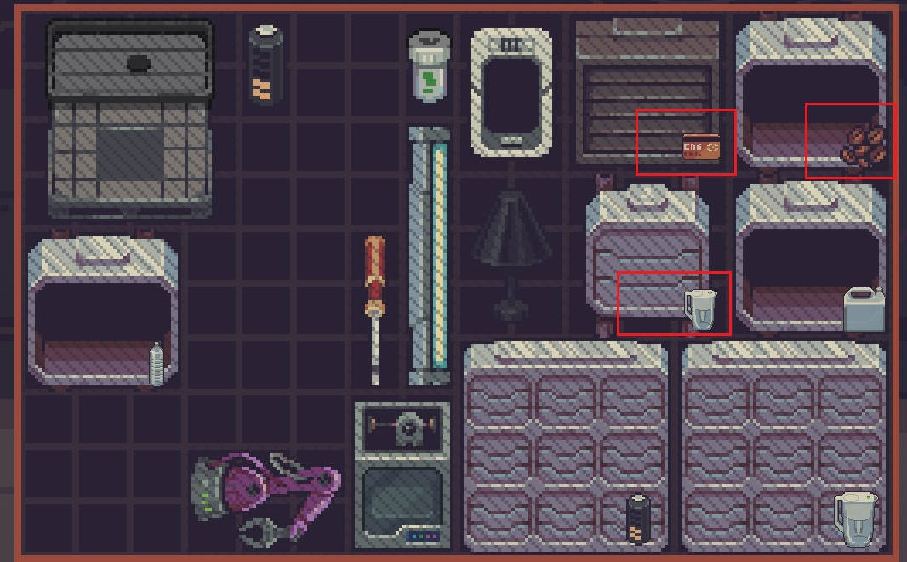
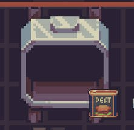
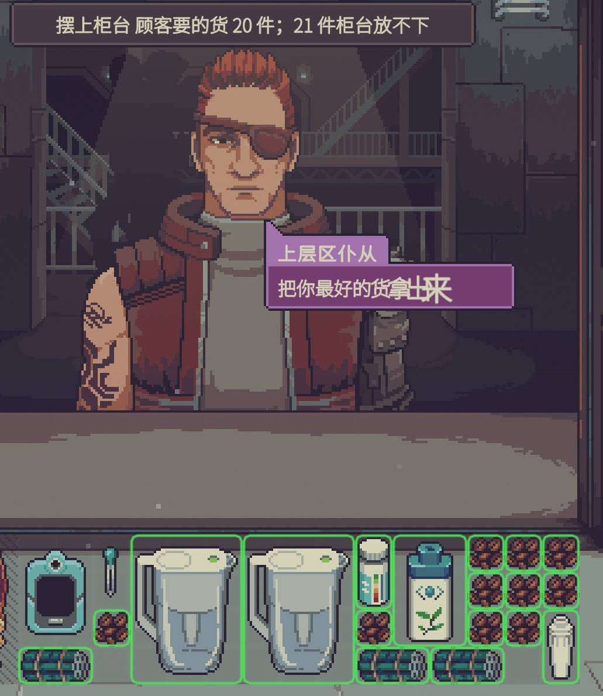
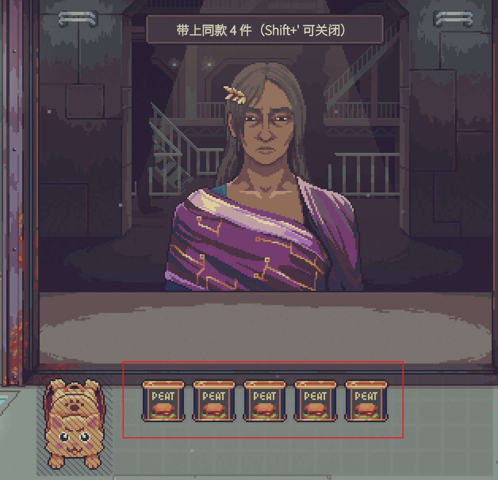

# [QoL] Shopkeeper's Kit: Sort To Boxes

**English** | [中文](README.zh-CN.md)

> Part of the **Shopkeeper's Kit** (掌柜帮手) series · category **[QoL]** (【便利】): no stat changes and no extra information, it only saves you clicks. See the [repository home](../../README.md) for the series and categories.
> By ChaosN · developed with assistance from [Claude Code](https://claude.com/claude-code) (Anthropic's AI coding assistant). Mod ID: `chaos5090.sort-to-boxes`.
>
> **Steam Workshop: [subscribe here](https://steamcommunity.com/sharedfiles/filedetails/?id=3835916464)**

A code mod for *Probably Stolen* (v0.46D) that takes care of two chores:

1. **Storing**: customers sell you all kinds of things. One key press sends each item into the right box (food box, household goods box, ...).
2. **Selling**: when a buyer arrives, one key press puts everything they would buy onto the counter. Or put one item up yourself and its identical copies follow.

The in-game UI is in Chinese and English and follows the game's language (Chinese when the game is in Chinese, English otherwise). Item and box names use the game's own translations.

## Screenshots

**Category panel**: open it with the "Sort" button on the storage window's title bar; tick whole categories or single items. The option at the top keeps the box out of the counter.



**Box badges**: the bottom-right corner shows what's inside each box.

 

**Selling**: left, one key puts everything the buyer would buy on the counter (green outlines; the message says how many didn't fit). Right, drag one can of synthetic meat onto the counter and the other 4 identical cans follow.

 

The screenshots use rebound keys (`;` and `'`); the defaults are G and C. The game was in Chinese.

## Keys

| Key | What it does |
|---|---|
| **G** | Sort loose items in **storage** into matching boxes |
| **G** while pointing at the **counter** | Put **your** items on the counter back into boxes; items with no matching box go back to storage (customer items are left alone) |
| **Ctrl+G** while pointing at a box | Open that box's **category panel** (or click the **Sort** button (**分类** in Chinese) in an open box window's title bar, just left of the close button ×) |
| **Shift+G** | Toggle **auto-sort on purchase** (off by default) |
| **C** | Put everything the current buyer **would buy** onto the counter |
| **C** while pointing at an item in **storage or a box** | Put all **identical** items onto the counter |
| **C** while pointing at your item **on the counter** | The reverse: take it and its **identical** copies on the counter back into boxes; items with no matching box go to storage |
| **Shift+C** | Toggle **bring identical items when you place one on the counter** (off by default) |

Every action shows a short notification in the top-left corner. Where each item went is written to the game log `Player.log` (search for `[SortToBoxes]`).

## Storing: sorting rules

The game's own item types number 50+, many with only one or two items, and one item often carries several. So this mod defines its own **categories**: as few as possible covering as many items as possible, **each item in exactly one category**. There are 13: Food, Drinks & water, Household, Medical, Chemistry, Weapons & ammo, Materials, Tools & equipment, Modules, Seeds & farming, Husbandry, Documents & cards, Luxury & collectibles, plus a catch-all Other. For example, the sugar-free juice (processed food, drink and food in the game) is a Drink, and the cat chocolate bar is Food.

Categories are derived from the game's item directories and types (rules in `tools/categories.py`, result table in `src/Generated/ItemCategories.cs`); items added by later game updates are classified from their types with the same rules.

For an upgraded storage bay, "box" below means **each tab** (see the next section).

0. A box set to **Keep out of sorting** never receives anything, and what it holds isn't used for decisions.
1. **Boxes with ticked categories** come first: a box with the item itself ticked wins, then a box with the item's category ticked.
2. **Untagged boxes** go by what they already hold:
   - a box holding an **identical** item is preferred;
   - otherwise a box holding items of the **same category** (the more such items, the higher the priority).
3. If the preferred box is full the next one is tried.
4. When those are full, items continue into an **empty, untagged tab of the same box** (only matters for upgraded storage bays, see the next section).
5. If nothing fits, the item stays where it is.

So:

- An **empty box** needs either one "sample" item inside, or ticked categories.
- Keep things for your own use (say, a box of medicine you use yourself) in a box set to **Keep out of sorting**, and sorting never adds new goods to it; tick **Keep out of the counter** too and the counter key won't take them either.
- Items you put into a box yourself are never taken out: sorting only moves loose items in storage (or on the counter).
- Items without any type (about 120 in the game) can only follow an identical item that is already in a box.
- Decisions are based on what the boxes held **before** the key press; items placed during this run don't change this run's decisions.

### Upgraded storage bays (tabs)

A storage bay upgraded with the **expansion kit** has several tabs (up to 5; switch with the tab headers at the top of the box window, double-click a tab name to rename it). This mod treats **each tab as a box of its own**:

- every tab has **its own settings**: ticked categories, Keep out of sorting, Keep out of the counter. For example tab 1 takes Medical, tab 2 Food, and tab 3 is kept out of sorting for your own gear;
- an untagged tab goes by what it already holds, like any box;
- **spare room**: when a tab is full, items continue into an **empty, untagged** tab of the same box (an empty tab takes only one category per sort, so categories don't get mixed). To keep an empty tab out of this, tick categories for it or set it to Keep out of sorting;
- the category panel opens on the tab the box window is **currently showing**; Ctrl+G while pointing at a tab header or inside a tab opens that tab. A row of tab buttons at the top of the panel switches between tabs (the one in 【】 is the one you're editing);
- messages and the log name a tab as "Storage Bay·Tab 2" (or the name you gave it).

Category ticks made for a whole box in 1.7 and earlier now belong to **tab 1** (in those versions the game only ever put sorted items into tab 1 of an upgraded box anyway); Keep out of the counter set for a whole box still covers the whole box (all tabs).

### Category panel

Ctrl+G while pointing at a box, or the **分类** button left of the close button × in an open box window's title bar, opens a window in the game's own UI style. Items are grouped by category:

- tick **【category】整类** ("whole category") at the top of a group: **every item under it is ticked**, and items of that category you only see later go into this box too;
- untick **整类**: **every item under it is unticked**;
- each item has its own checkbox (with its icon) and can be ticked on its own. Unticking one item while the whole category is ticked switches to "every item except this one". The ×N after a name is how many you have in storage and boxes;
- **only items you have seen in this save are listed** (anything that has been in your storage, boxes, machines, counters or display case). At first it's just what you own; the list grows as you see more goods, so nothing is spoiled. The record is kept in the save, one per save;
- two switches at the top: **Keep out of sorting** (sorting, auto-sort on purchase and taking items back from the counter never put anything here; while it's on, the category ticks below don't apply but are kept) and **Keep out of the counter**;
- upgraded storage bays: a row of tab buttons at the top, each tab set up on its own (see the previous section);
- ticks take effect immediately and are **saved with your save file** (stored on the box itself);
- **全部取消** ("Clear all") switches the box back to "go by what it holds";
- if you uninstall the mod, the leftover marks and records in your save do nothing.

### Box icons

Each box in storage (storage bays, etc.) gets a small badge in the **bottom-right corner** of its sprite, so you can tell what a cabinet holds without opening it:

- a box with items shows the icon of its **first item** (the top-left one); if the box has ticked categories, the first item of a ticked type is preferred;
- an empty box with ticked categories borrows the icon of an item of that type from your stock; if you have none, it shows a small chip in the type's color.

The badge moves with the box, hides while the box is dragged, and never blocks clicks. It works alongside **Show Item Names** (物品名称常显), whose "分" page badge sits in the bottom-left corner. Turn off `boxIcons` if you don't want it.

### What counts as a box

Anything of yours in storage (including boxes inside boxes) that the game classes as storage: storage bays of all kinds, the smuggler compartments, the hypertech bay, machine bays, the toolbox, and all backpacks.

Not boxes: the trash can, the dossier, seed packets, locked supply crates, machines.

## Selling: putting goods on the counter

The counter can hold many items at once, but the customer negotiates **one item at a time** (the last item placed comes first; when it's sold the next one is up). Put everything up once and you only need to click "sell" for each.

- **C**: put everything the current buyer would buy onto the counter. "Would buy" uses the game's own rule, the same function the game uses to decide whether a customer wants an item. By default only items the customer **can afford** are put up (they won't buy the rest anyway; turn off `onlyAffordable` to change this), more valuable first, so they get the space if the counter fills up.
- **C while pointing at an item in storage or a box**: put all identical items from storage and boxes onto the counter, with or without a customer present.
- **C while pointing at an item on the counter**: the reverse; that item and its identical copies on the counter go back (same box rules as G; no matching box means storage). Put up too many or the wrong ones? The same key undoes it.
- **Bring identical items** (optional, off by default; Shift+C turns it on): while a buyer is at the counter, when you move one item from storage or a box onto the counter (drag it or Shift+click it), its **identical** copies in your stock follow automatically. Only the move "from your stock to the counter" triggers this; items the game itself moves to the counter, for example when a barter completes, do not. It's off by default because sometimes you want just one; to put a whole batch up, point at the item and press C.
- When you're done, point at the counter and press **G**: what's left goes back to boxes or storage.

**Identical** means the same item with everything you can see in its tooltip matching: type labels, grades (water quality, drug purity, condition; the tested grade if tested, otherwise the apparent grade, so nothing hidden is revealed), and whether the bottle holds any liquid other than water, and which. A bottle of alcohol and a bottle of water are not identical, nor are waters with different apparent grades.

Never put on the counter:
- pinned items;
- anything in a box (or a tab of an upgraded storage bay) marked **Keep out of the counter** (top of the category panel): put your own equipment (water purifiers, scanners, ...) and things you won't sell in such a box;
- **your own mixtures**: a plain bottle holding liquids other than water (alcohol, reagents, ...). The game treats every liquid bottle as "water", so a water buyer would take it at water prices. Proper chemical products and wine bottles are not affected;
- equipment the game marks as important (appraisal guides, newspapers, backpacks, machines, storage bays, ...); items in the display case.

Drug purity takes care of itself: the game decides which purity each customer accepts, so substandard drugs never count as "would buy".

## What never moves

- **Pinned** items (pin anything you want to stay where it is);
- boxes, backpacks and other containers themselves; machines; ship systems;
- items that aren't yours, or that are locked in place;
- when sorting: the item currently being negotiated, and items already inside boxes (only loose items at the top level of storage are sorted).

Items are placed with the game's own placement function, so each box's own rules still apply (e.g. a regular storage bay doesn't take machines).

## Install

**Recommended:** subscribe on the [Steam Workshop](https://steamcommunity.com/sharedfiles/filedetails/?id=3835916464), then in game open **Mods**, select the mod, click **Review and enable** and restart when asked. Steam keeps it updated.

Manual install (building from source):

1. Copy the whole `dist/SortToBoxes/` folder into the game's `Mods` folder:
   ```
   <game folder>/Mods/SortToBoxes/manifest.xml
   <game folder>/Mods/SortToBoxes/SortToBoxes.dll
   ```
   The game folder is `steamapps\common\Probably Stolen` in your Steam library (in Steam: right-click the game → Manage → Browse local files). To build from source, see the [repository home](../../README.md).
2. Start the game → main menu **改装件** (Mods) → select **【便利】掌柜帮手·归类入箱** → **审阅并启用** (Review and enable) → restart when asked.
3. The mod requests **no special capabilities**. The game's own mod scanner ([`tools/ScanCheck`](../../tools/ScanCheck)) reports no capabilities, no blocks and no findings.

## Settings

In game: Mods screen → select this mod → **设置** (Settings). Or edit `%USERPROFILE%\AppData\LocalLow\Questing Goose Studio\Probably Stolen\ModConfigs\chaos5090.sort-to-boxes.json`.

| Key | Default | Meaning |
|---|---|---|
| `hotkey` | `G` | Sort key (Unity KeyCode name). The defaults sit under the left hand and avoid the game's own keys (Q E R F S P K O B, Space, digits) and F5/F6/F8 used by popular mods |
| `sellHotkey` | `C` | Counter key. **F** works too: the game's F (flip) only acts while you drag an item, and while dragging this mod leaves the key to the game. The game's Options refuse F because it's the flip key, so type `F` in this mod's settings (Mods → this mod → Settings) |
| `autoOnPurchase` | `false` | Auto-sort goods you buy from customers (also Shift+G in game) |
| `autoSameOnCounter` | `false` | Bring identical items when you place one on the counter (also Shift+C in game) |
| `boxButtons` | `true` | Show the 分类 button in open box windows' title bar (left of ×) |
| `boxIcons` | `true` | Draw the icon of a box's contents on the box |
| `onlyAffordable` | `true` | C only puts items the buyer can afford on the counter |

## Other mods

- **Smart Inventory Arrange (F6)** only rearranges items inside one box and never moves items between boxes, so the two don't conflict. Sort with G, then tidy a box with F6.
- **Client Demand Highlight (F5)** outlines the items a customer wants; C here puts those items on the counter. Both use the game's same "would the customer buy this" rule.
- **Purchase Stay Counter** keeps bought goods on the counter, so auto-sort on purchase won't fire; point at the counter and press G instead.

## Implementation

| File | Contents |
|---|---|
| `src/Stock.cs` | What counts as a box, what can move, the extent of your stock; reading/writing box category marks (`#category`, `@item-id`) |
| `src/Categories.cs`, `src/Generated/ItemCategories.cs`, `tools/categories.py` | The 13 categories: the generator assigns each item one category from the game's item directories + types; items not in the table use the same rules on their types |
| `src/Sorter.cs` | Sorting: tally box contents, rank boxes for each item, place via `GraphUtils.TryAcceptAll` |
| `src/Counter.cs` | Selling: buyer's items / identical items to the counter (`StoreClient.IsClientBuyingThisItem`, `HasBudgetLeftToBuy`), clearing the counter |
| `src/Patches.cs` | Postfix on `PlayerStore.MoveDealItemToInventory` (auto-sort on purchase); prefix/postfix on `SlotMarker.TryAcceptOnce` (detects "stock → counter" moves to bring identical items) |
| `src/BoxLabelPanel.cs`, `src/BoxButtons.cs` | Category panel (the game's CustomUI framework); the 分类 button left of × (a TreeNodeRender on the window, like ×, using the game's mouse events) |
| `src/BoxIcons.cs` | Content badge in each box's bottom-right corner (a child node under the box's render node `GameItemElement.handler`) |
| `src/SeenItems.cs` | Per-save record of items you have seen (`ModHelper.SetModData`, stored in the save) |
| `src/SortBehaviour.cs` | Hotkeys and notifications |
| `src/SortConfig.cs` | Settings via the game's ModConfig |

**Status**: builds and passes the game's mod scanner. 1.8.0 (tabs, Keep out of sorting) is **not yet tested in game**. 1.1.0 was tried in game: G on the counter, the 分类 button and box icons work (the button sat too far from the window and the icon was too big; both changed in 1.2.0). The 1.2.0 changes are **not yet tested in game**. The 分类 button is attached to the box window itself (same parent as the × button); if it looks wrong, turn off `boxButtons` and use Ctrl+G. If the box icons look wrong, turn off `boxIcons`.

## Changelog

- **1.8.0**: Upgraded storage bays (expansion kit, several tabs): each tab is treated as a box of its own, with its own categories, Keep out of sorting and Keep out of the counter; tab buttons at the top of the category panel switch between tabs; when a tab is full, items continue into an empty, untagged tab of the same box. Fix: sorting into an upgraded box used to put items only into tab 1 and reported "doesn't fit" once tab 1 was full. New **Keep out of sorting** switch: your own medicine or gear stash no longer gets new goods stuffed into it.
- **1.7.0**: The counter key (C) now works both ways depending on what you point at: an item in storage or a box puts its identical copies on the counter; an item on the counter takes its identical copies back into boxes or storage. While you drag an item, a hotkey that matches the game's flip/rotate/reset key is left to the game (so the counter key can be F).
- **1.6.0**: Default keys moved under the left hand: sort **G**, counter **C** (previously F7 / F4; next to the game's Q/E rotate keys); keys you already saved are kept. Rebinding a key in the game's Options no longer triggers sorting or the counter key; messages show the key you actually set.
- **1.5.1**: "Bring identical items" is now off by default: dragging one item onto the counter moves just that one; point at an item and press F4 for the whole batch (an existing "on" setting is kept; Shift+F4 turns it off).
- **1.5.0**: "identical" now compares what you can see (types, grades such as water quality and drug purity, non-water liquids in a bottle), so alcohol bottles no longer follow water bottles; F4 by default only puts items the buyer can afford and never your own mixtures; boxes can be marked "keep out of the counter".
- **1.4.2**: No longer makes the game try to create a new save object in the main menu (it used `PlayerStore.Instance` to check whether a run is loaded; that getter creates one when none exists, which crashed in the constructor with a null reference). The Sort button now matches the close button × (light gray, dark outline, dark red text); the old beige-on-cream was hard to read.
- **1.4.1**: fixed repeated null-reference errors when recording seen items (the game's item-tree walk doesn't check for null nodes; the mod now uses its own); every box/item walk now skips null nodes; the Sort button explicitly enables its image and text and logs its position the first few times it's created (to track down the invisible button).
- **1.4.0**: UI in Chinese and English, following the game language (notifications, category panel, the Sort button, category names, settings).
- **1.3.1**: fixed 1.3.0's manifest (an unescaped `&` in the English description made the game skip the whole mod); hotkeys can be bound in the game's Options, and the settings also accept a plain symbol (e.g. /).
- **1.3.0**: the mod's own 13 categories (each item in exactly one) replace the game's fragmented types; the category panel groups by category, ticking a whole category ticks every item under it and unticking clears them all; types ticked in 1.2 are converted to their category.
- **1.2.1**: the 分类 button moved into the box window's title bar, right next to the close button × (attached to the window itself, so no more gap).
- **1.2.0**: the category panel now lists items: seen items grouped by type, with icons, tick a whole type or single items; only items seen in this save are listed; the 分类 button sits right against the box window; the box icon is now a small badge in the bottom-right corner.
- **1.1.0**: sorting now uses the first item type; new box category panel and 分类 button; content icons on boxes; new selling helpers (F4 for the buyer's items, F4 on an item for identical items, bring identical items when placing one); F7 on the counter sends items without a matching box back to storage.
- **1.0.0**: first version: F7 sorting (by type overlap), Shift+F7 auto-sort on purchase.
