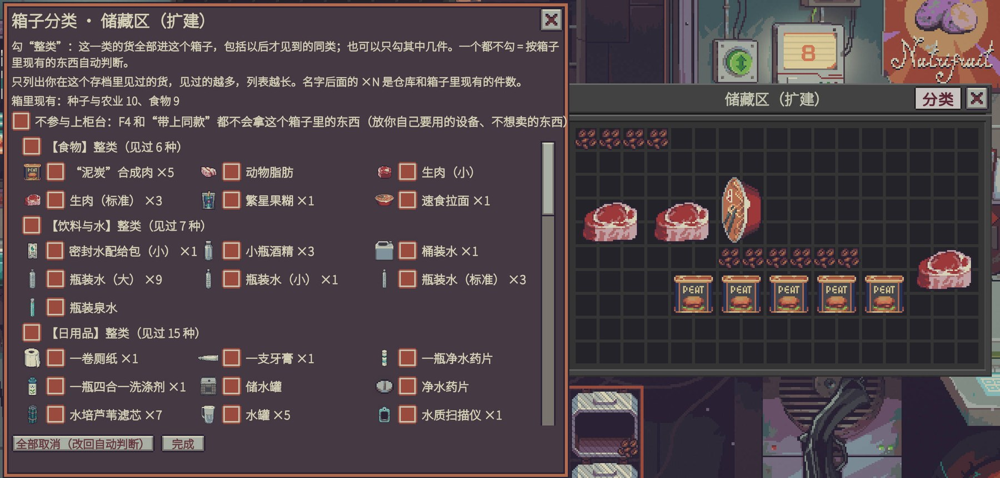
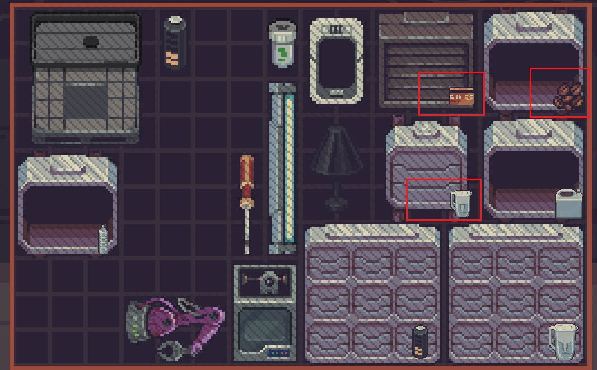
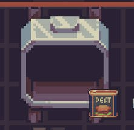
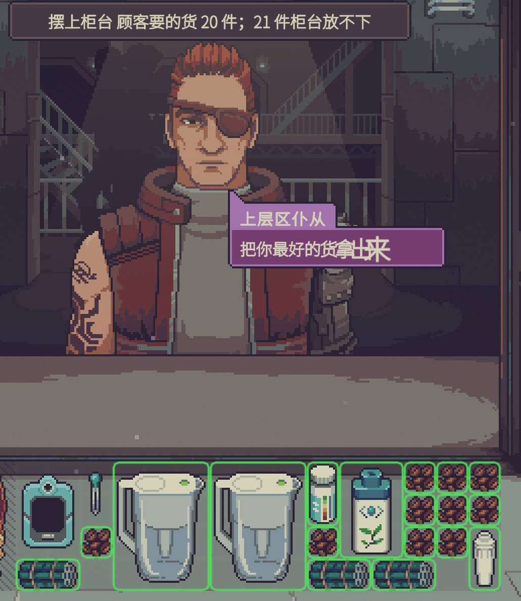
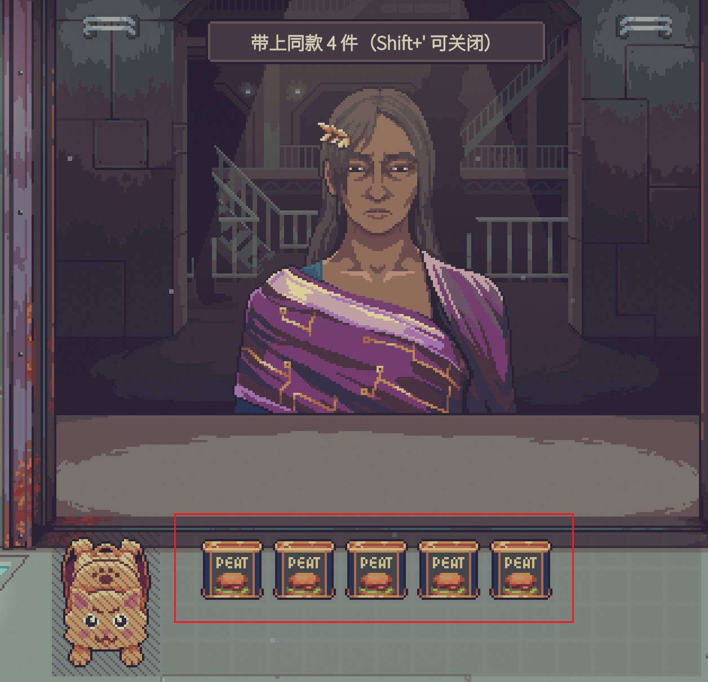

# 【便利】掌柜帮手·归类入箱 Sort To Boxes

[English](README.md) | **中文**

> **掌柜帮手 / Shopkeeper's Kit** 系列 · 分类 **【便利】**：不改任何数值、不给额外信息，只帮你省操作。系列与分类说明见 [仓库首页](../../README.zh-CN.md)。
> 作者 ChaosN · 由 [Claude Code](https://claude.com/claude-code)（Anthropic 的 AI 编程助手）协助开发。mod ID：`chaos5090.sort-to-boxes`。
>
> **Steam 创意工坊：[点这里订阅](https://steamcommunity.com/sharedfiles/filedetails/?id=3835916464)**

《Probably Stolen》（v0.46D）的代码 mod，管两件麻烦事：

1. **收货**：顾客卖来的东西什么都有，按一下就各自归进对应的箱子（食物箱、日用品箱……）。
2. **卖货**：买家来了，按一下就把他会买的货全部摆上柜台；或者你放一件上去，同款的自动跟上。

界面中英双语，跟随游戏的语言设置（中文显示中文，其他语言显示英文）。物品名、箱子名用游戏自己的翻译。

## 截图

**分类面板**：点储藏区标题栏上的“分类”按钮打开，勾整类或单件；最上面可以设“不参与上柜台”。



**箱子上的小图标**：右下角显示箱子里装的是什么。

 

**卖货**：左边是一键把顾客会买的货摆上柜台（绿框是摆上去的，柜台放不下的件数会提示出来）；右边是拖一罐合成肉上柜台，另外 4 罐同款自动跟上。

 

截图里的快捷键是改过的（`;` 和 `'`），默认是 G 和 C。

## 按键一览

| 按键 | 作用 |
|---|---|
| **G** | 把**仓库**里散放的货归进对应的箱子 |
| 鼠标指着**柜台** 按 **G** | 把柜台上**你的**货放回箱子；没有对应箱子的放回仓库（顾客的东西不动） |
| **Ctrl+G** 指着箱子 | 打开这个箱子的**分类面板**（也可以点打开的箱子窗口标题栏里、关闭按钮 × 左边的 **分类** 按钮） |
| **Shift+G** | 开关“**买下时自动归箱**”（默认关） |
| **C** | 把当前买家**会买的货**全部摆上柜台 |
| 鼠标指着**仓库或箱子里**的某件货 按 **C** | 把它的**同款**全部摆上柜台 |
| 鼠标指着**柜台上**你的某件货 按 **C** | 反过来：把它和柜台上的**同款**收回箱子，没有对应箱子的放回仓库 |
| **Shift+C** | 开关“**放一件上柜台时带上同款**”（默认关） |

每次操作后左上角会弹一条提示，例如 `归箱 7 件（储藏区 4、工具箱 3）；2 件没有对应箱子`。每件货的去向写在游戏日志 `Player.log` 里（搜 `[SortToBoxes]`）。

## 收货：归箱规则

游戏自带的“类型”有 50 多种，很多只有一两件，一件货还常常挂好几个类型。所以本 mod 自己定了一套**大类**：用尽量少的类覆盖尽量多的货，**每件货只属于一个类**。一共 13 类：食物、饮料与水、日用品、医疗、化学、武器与弹药、材料、工具与设备、模组、种子与农业、养殖、文件证件、奢侈品与收藏，另有一个“其他”兜底。例如代糖果汁（游戏里同时是加工食品、饮料、食物）归“饮料与水”，猫咪巧克力棒归“食物”。

大类是按游戏的物品目录和类型定的（规则在 `tools/categories.py`，结果表在 `src/Generated/ItemCategories.cs`）；游戏更新后新出现的物品，按同一套规则只看类型来分。

下面说的“箱子”，对升级过的储藏区来说指的是**每一栏**（见下一节）。

0. 设了“**不参与归箱**”的箱子：从不往里放东西，里面的东西也不拿来判断。
1. **勾选过分类的箱子**优先：勾了这件物品本身的箱子最优先，其次是勾了它所属大类的箱子。
2. **没勾选的箱子**看里面现有的东西：
   - 箱子里有**一模一样**的物品 → 优先放这里；
   - 否则放进装着**同一大类**货的箱子（这类货越多越优先）。
3. 首选箱子放不下就试下一个。
4. 都放满了，再放进**同一个箱子里空着、没勾分类的栏**（只对升级过的储藏区有用，见下一节）。
5. 还是放不下就留在原地。

所以：

- **空箱子**要么先放一件“样品”进去，要么直接勾选分类。
- 自己用的东西（例如一箱自用的药品）放进设了“不参与归箱”的箱子，归箱就不会再往里塞新货；再勾上“不参与上柜台”，上柜台键也不会拿它们。
- 你自己手动放进箱子的东西，mod 不会拿出来：归箱只搬仓库（或柜台）上散放的货。
- 判断依据是按键**之前**箱子里的东西，本次放进去的货不改变本次的判断。

### 升级过的储藏区（多栏）

储藏区用了**扩容套件**会分成多栏（最多 5 栏，箱子窗口顶上的栏头可以切换，双击栏名能改名）。本 mod 把**每一栏当成一个独立的箱子**：

- 每栏**单独设置**：分类勾选、“不参与归箱”、“不参与上柜台”都按栏。比如第 1 栏勾“医疗”、第 2 栏勾“食物”，第 3 栏设“不参与归箱”放自用装备；
- 没勾分类的栏照样看栏里现有的东西判断；
- **后备空间**：某一栏放满了，会接着放进同一个箱子里**空着、没勾分类**的栏（每个空栏一次归箱只接一类货，不会混在一起）。不想让某个空栏被这样用，就给它勾分类或设“不参与归箱”；
- 打开分类面板时默认是箱子窗口**当前显示的那一栏**；指着某一栏的栏头或栏里按 Ctrl+G 就是那一栏。面板顶上有每一栏的按钮（【】括起来的是正在设置的栏），点一下切换；
- 提示和日志里写作“储藏区·第2栏”（改过名的栏用你起的名字）。

1.7 及以前的版本对整个箱子的分类设置，现在对应**第 1 栏**（那些版本往升级过的箱子里归箱，游戏本来也只会放进第 1 栏）；“不参与上柜台”原来对整个箱子，现在仍对整个箱子（每一栏都勾着）。

### 分类面板

指着箱子按 **Ctrl+G**，或点打开的箱子窗口标题栏里、关闭按钮 × 左边的 **分类** 按钮，会弹出一个游戏原生风格的窗口。货按大类分组：

- 勾上每组开头的 **【大类】整类**：下面的货**全部勾上**，这一类以后才见到的货也进这个箱子；
- 取消 **整类**：下面的货**全部取消**；
- 组里每件货一个勾选框（带图标），也可以单独勾。整类勾着时取消其中一件，会自动改成“除了这件以外逐件勾选”。名字后面的 ×N 是仓库和箱子里现有的件数；
- **只列出你在这个存档里见过的货**（在仓库、箱子、机器、柜台、展示柜里出现过的）。刚开始只有你手上的东西，见过的货越多列表越长，没见过的不会剧透。这份记录存在存档里，每个存档各一份；
- 最上面两个开关：**不参与归箱**（归箱、买下自动归箱、柜台收回都不往这里放；打开后下面的分类勾选暂不生效，但会保留）、**不参与上柜台**；
- 升级过的储藏区：顶上一排栏按钮，每栏单独设置（见上一节）；
- 勾选立即生效，并**随存档保存**（存在箱子自己身上）；
- **全部取消** = 改回“看箱子里现有的东西”；
- 卸载 mod 后，存档里留下的分类标记和见过的记录不影响游戏。

### 箱子图标

仓库里的箱子（储藏区等）图标**右下角**会画一个角标（对角线约为箱子对角线的一半，方形箱子就是边长的一半），不用打开就知道柜子里装的是什么：

- 箱子里有东西：画**第一件物品**（左上角那件）的图标；勾选过分类时，优先用属于勾选类型的那件；
- 勾选了分类但箱子是空的：借仓库里一件同类物品的图标；仓库里也没有，就画一块该类型颜色的小色块。

角标跟着箱子移动、拖动箱子时隐藏，不挡鼠标点击。和“物品名称常显 / Show Item Names”可以一起用：它的“分”字角标在左下角，本角标在右下角。不想要可以在设置里关掉 `boxIcons`。

### 哪些算“箱子”

仓库里（包括放在箱子里的箱子）**属于你的**：储藏区、简易储藏区、储藏区（扩建）、枪械师/化学师储藏区、走私者暗格、超科技储藏区、机器区、工具箱等“储藏”类物品，以及各种背包。

不算箱子：垃圾桶、档案夹、种子包、上锁的物资箱、机器。

## 卖货：摆上柜台

柜台上可以同时放很多件货，但顾客是**一件一件**议价的（最后放上去的那件先谈，卖掉后自动轮到下一件）。所以一次摆好，就只剩一件件点“卖”。

- **C**：把当前买家会买的货全部摆上柜台。判断“会不会买”用的是游戏自己的规则（和游戏判断顾客要不要这件货是同一个函数）。默认只摆顾客**买得起**的（买不起的摆上去他也不会买；设置 `onlyAffordable` 可关），贵的先放，柜台放不下时先保证这些。
- **指着仓库或箱子里的某件货按 C**：把仓库和箱子里它的同款全部摆上柜台，不管柜台前有没有顾客。
- **指着柜台上的某件货按 C**：反过来，把它和柜台上的同款一起收回（归箱规则和 G 一样，没有对应箱子的放回仓库）。摆多了、摆错了，同一个键就能撤回。
- **放一件带同款**（可选，默认关，Shift+C 打开）：柜台前有买家时，你从仓库或箱子里拿一件货放上柜台（拖上去或 Shift+点击都行），库存里的**同款**会自动跟着摆上去。只认“从仓库/箱子放到柜台”这个动作；以物易物成交时游戏自己挪到柜台的货不会触发。默认关，是因为有时你只想拿一件；要整批摆，指着货按 C 更直接。
- 卖完了，鼠标指着柜台按 **G**，剩下的货回到箱子或仓库。

**同款**是指：同一种物品，而且物品提示里看得到的东西都一样：类型标签、等级（水质、药品纯度、品相；检测过按真实等级，没检测过按表面等级，不会替你偷看）、瓶子里有没有、有哪些水以外的液体。所以装酒精的瓶子和装水的瓶子不算同款，表面等级不同的水也不算。

不会被摆上柜台的：
- 钉住的物品；
- 放在“**不参与上柜台**”箱子（或升级储藏区的某一栏）里的东西（在分类面板最上面勾选）：你自己要用的设备（净水器、扫描仪……）、不想卖的东西，集中放进这样的箱子就不会被摆出去；
- **你自己调配的混合液**：普通瓶子里装了水以外的液体（酒精、试剂……）。游戏把装液体的瓶子都当“水”，这种瓶子摆上去会被买水的顾客按水价收走。正规的化学成品和酒瓶不受影响；
- 游戏标为“重要”的装备（鉴定指南、报纸、背包、机器、储藏区等）；展示柜里的东西。

药品的纯度不用操心：每位顾客能接受的纯度由游戏自己判断，不合格的本来就不会被当成“会买”。

## 哪些东西不会被搬

- **钉住**的物品（想让某样东西一直留在原处，就把它钉住）；
- 箱子、背包、其他容器本身；机器；飞船系统类设施；
- 不属于你的东西、被锁住拿不出来的东西；
- 归箱时：正在议价的那件，以及已经在箱子里的东西（只整理仓库最外层散放的货）。

放置用的是游戏自己的放置函数，箱子原有的放入规则照样生效（例如普通储藏区不收机器）。

## 安装

**推荐：**在 [Steam 创意工坊](https://steamcommunity.com/sharedfiles/filedetails/?id=3835916464)点订阅，进游戏打开 **改装件**，选中它点 **审阅并启用**，按提示重启。以后有新版本 Steam 会自动更新。

下面是手动安装（从源码构建）的步骤：

1. 把 `dist/SortToBoxes/` 整个文件夹复制到游戏目录的 `Mods` 文件夹里：
   ```
   <游戏目录>/Mods/SortToBoxes/manifest.xml
   <游戏目录>/Mods/SortToBoxes/SortToBoxes.dll
   ```
   游戏目录在 Steam 库的 `steamapps\common\Probably Stolen`（Steam 里右键游戏 → 管理 → 浏览本地文件）。从源码构建见[仓库首页](../../README.zh-CN.md)。
2. 启动游戏 → 主菜单 **改装件** → 选中 **【便利】掌柜帮手·归类入箱** → **审阅并启用** → 按提示重启游戏。
3. 本 mod **不申请任何特殊权限**；用游戏自带的扫描器检查（[`tools/ScanCheck`](../../tools/ScanCheck)）结果是无权限、无拦截、无发现。

## 设置

游戏内：改装件界面选中本 mod → **设置**；或编辑 `%USERPROFILE%\AppData\LocalLow\Questing Goose Studio\Probably Stolen\ModConfigs\chaos5090.sort-to-boxes.json`。

| 键 | 默认 | 说明 |
|---|---|---|
| `hotkey` | `G` | 归箱热键（Unity KeyCode 名称）。默认键都在左手区，避开了游戏自带键（Q E R F S P K O B、空格、数字）和常见 mod 的 F5/F6/F8 |
| `sellHotkey` | `C` | 上柜台热键。想用 **F** 也可以：游戏的 F（翻转）只在拖着物品时起作用，拖着东西时本 mod 会让给游戏。游戏“选项”里会因为和翻转键重复而不让绑，要在改装件 → 本 mod 的设置里直接填 `F` |
| `autoOnPurchase` | `false` | 买下顾客的货时自动归箱（游戏里 Shift+G 也能切换） |
| `autoSameOnCounter` | `false` | 放一件上柜台时带上同款（游戏里 Shift+C 也能切换） |
| `boxButtons` | `true` | 在打开的箱子窗口标题栏（× 左边）显示“分类”按钮 |
| `boxIcons` | `true` | 在箱子上显示里面物品的小图标 |
| `onlyAffordable` | `true` | C 只摆顾客买得起的货 |

## 与其他 mod

- **智能整理（Smart Inventory Arrange，F6）**：它只在单个箱子里重新排位置，不跨箱子分类，和本 mod 不冲突。可以先 G 归箱，再对箱子按 F6 排整齐。
- **客户需求高亮（F5）**：它给顾客想要的货描边；本 mod 的 C 直接把这些货摆上柜台。两者用的是游戏同一套“顾客买不买”的规则。
- **购买留柜（Purchase Stay Counter）**：它让买下的货留在柜台，此时“买下时自动归箱”不会触发；指着柜台按 G 即可。

## 实现

| 文件 | 内容 |
|---|---|
| `src/Stock.cs` | 什么算箱子、什么货能搬、库存范围；箱子分类标记的读写（`#大类`、`@物品id`） |
| `src/Categories.cs`、`src/Generated/ItemCategories.cs`、`tools/categories.py` | 13 个大类：生成器按游戏物品目录 + 类型给每件货定一个类；表里没有的物品按类型套用同一规则 |
| `src/Sorter.cs` | 归箱：统计箱子内容、给每件货排箱子、调用 `GraphUtils.TryAcceptAll` 放入 |
| `src/Counter.cs` | 卖货：买家会买的货 / 同款上柜台（`StoreClient.IsClientBuyingThisItem`、`HasBudgetLeftToBuy`），清空柜台 |
| `src/Patches.cs` | `PlayerStore.MoveDealItemToInventory` 后置（买下自动归箱）；`SlotMarker.TryAcceptOnce` 前后置（识别“从库存放到柜台”，触发带同款） |
| `src/BoxLabelPanel.cs`、`src/BoxButtons.cs` | 分类面板（游戏的 CustomUI 框架）；标题栏 × 左边的“分类”按钮（和 × 一样是挂在窗口上的 TreeNodeRender，用游戏的鼠标事件） |
| `src/BoxIcons.cs` | 箱子右下角的物品小角标（挂在箱子的渲染节点 `GameItemElement.handler` 下） |
| `src/SeenItems.cs` | 本存档见过的物品记录（`ModHelper.SetModData`，存在存档里） |
| `src/SortBehaviour.cs` | 热键、提示文字 |
| `src/SortConfig.cs` | 游戏自带 ModConfig 的配置项 |

**状态**：已编译、已通过游戏扫描器检查。1.8.0（多栏、不参与归箱）、1.8.1（角标放大）、1.8.2（分类折叠）**尚未实测**。1.1.0 已进游戏试过：指着柜台按 G、“分类”按钮、箱子图标都能用（按钮离窗口太远、图标太大，已在 1.2.0 修改）；1.2.0 的改动**尚未实测**。“分类”按钮挂在箱子窗口自己身上（和 × 同一个父节点），如果显示不对，可以在设置里关掉 `boxButtons`，改用 Ctrl+G；箱子图标的大小、位置如果不合适，可以关掉 `boxIcons`。

## 更新记录

- **1.8.2**：分类面板的大类可以折叠：默认收起，只显示“整类”那一行和“已勾 N/种类数”；点前面的“展开 / 收起”看里面的货，顶上有“全部展开 / 全部收起”。展开状态在这次游戏里记住，原地展开不重画，滚动位置不变。
- **1.8.1**：箱子角标放大：对角线约为箱子对角线的一半（原来是较短边的 30%），细长的箱子不超过较短边的 80%。
- **1.8.0**：支持升级过的储藏区（扩容套件，多栏）：每栏当成一个独立的箱子，分类、“不参与归箱”、“不参与上柜台”都按栏设置，分类面板顶上可切换栏；某一栏放满了接着放同箱空着、没勾分类的栏。修复：以前往升级过的箱子归箱只会放进第 1 栏，第 1 栏满了就报“放不下”。新增“**不参与归箱**”开关：自用的药品、装备区不会再被塞进新货。
- **1.7.0**：上柜台键（C）按指着的位置决定方向：指着仓库/箱子里的货是把同款摆上柜台，指着柜台上的货是把同款收回箱子/仓库。拖着物品时，如果热键和游戏的翻转/旋转/复位键相同，让给游戏（所以上柜台键可以设成 F）。
- **1.6.0**：默认键改到左手区：归箱 **G**、上柜台 **C**（原来是 F7 / F4，挨着游戏的 Q/E 旋转更顺手）；已经保存过的键位不变。在游戏“选项”里改键时不再顺带触发归箱/上柜台；提示文字显示你实际设置的键。
- **1.5.1**：“放一件带同款”默认改为关：拖一件上柜台就只上一件，要整批摆就指着货按 F4（已开着的设置不受影响，Shift+F4 可关）。
- **1.5.0**：“同款”按看得到的标签区分（类型、水质/药品纯度等等级、瓶子里水以外的液体），酒精瓶不再跟着水瓶上柜台；F4 默认只摆顾客买得起的、不摆你自己调配的混合液；箱子可设“不参与上柜台”。
- **1.4.2**：主菜单里不再反复触发游戏新建存档对象（原来用 `PlayerStore.Instance` 判断是否在店里，而它在没有存档时会新建一个，于是在构造函数里报空引用）。“分类”按钮改成和关闭按钮 × 一样的配色（浅灰底、深色描边、深酒红色的字），原来米色底配浅色字看不清。
- **1.4.1**：修复“见过的物品”记录反复报空引用（游戏的物品树遍历函数不检查空节点，改用自己的遍历）；所有找箱子、找物品的遍历都换成会跳过空节点的版本；“分类”按钮显式打开图片和文字，并在日志里记录前几次创建时的位置（排查按钮看不见的问题）。
- **1.4.0**：界面中英双语，跟随游戏语言（提示、分类面板、“分类”按钮、大类名称、设置项）。
- **1.3.1**：修复 1.3.0 的 manifest 里英文简介的 `&` 没转义、游戏读不了而跳过整个 mod；热键可以在游戏“选项”里按键绑定，设置里也能直接填符号（例如 /）。
- **1.3.0**：改用本 mod 自己的 13 个大类（每件货只属于一个类），代替游戏零碎的类型；分类面板按大类分组，勾整类 = 下面全勾，取消整类 = 下面全取消；1.2 勾过的类型自动换算成对应的大类。
- **1.2.1**：“分类”按钮挪进箱子窗口标题栏，紧挨关闭按钮 × 的左边（挂在窗口自己身上，不会再有空隙）。
- **1.2.0**：分类面板改成按物品：按类型分组列出见过的每件货（带图标），可勾整类或单件；只列本存档见过的货；“分类”按钮贴紧箱子窗口；箱子图标改成右下角的小角标。
- **1.1.0**：归箱改为以第一个标签为准；新增箱子分类面板与“分类”按钮；箱子上显示里面物品的小图标；新增卖货功能（F4 摆上买家会买的货、指着货按 F4 摆同款、放一件带同款）；指着柜台按 F7 时，没有对应箱子的货放回仓库。
- **1.0.0**：首版：F7 归箱（按类型重合度）、Shift+F7 买下时自动归箱。
